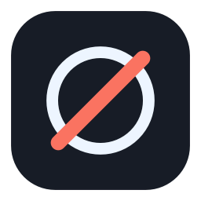

<p align="center"></p>

# Deceive for macOS

[](https://github.com/jcardonne/deceive-mac/releases/latest)
[](https://github.com/jcardonne/deceive-mac/actions/workflows/build.yml)
[](LICENSE)

Appear offline in **League of Legends**, **Teamfight Tactics** and **Legends of Runeterra**
on macOS while keeping lobby chat, champion select chat and invites. A menu bar port of
[Deceive](https://github.com/molenzwiebel/Deceive) for Windows: no terminal, no config files.

## Install

1. Download the DMG for your Mac from
   [Releases](https://github.com/jcardonne/deceive-mac/releases/latest):
   `arm64` for Apple Silicon, `x64` for Intel.
2. Drag **Deceive** into **Applications**.
3. First launch: right-click **Deceive** → **Open** → **Open**. The app is not notarized, so
   macOS asks once. On macOS 15+: allow it in *Privacy & Security*.
4. Quit the Riot Client if it is open (Deceive offers to do it), double-click Deceive and
   pick your game.

## Use

Click the eye in the menu bar:

| Item | What it does |
| --- | --- |
| Appear offline / mobile / online | masks your status, shows the phone icon, or stops masking |
| Masking enabled | master switch, keeps the status you picked |
| Restart into … | relaunches the Riot Client into another game |
| Show log / Quit | opens the log; quit also closes the Riot Client |

The header line says whether the client is connected. A fake friend **Deceive Active!**
accepts `offline`, `mobile`, `online`, `enable`, `disable` and `status` in game chat.

## FAQ

- **Friends cannot invite me.** Expected: you appear offline. Switch to *Appear online*,
  invite them, switch back.
- **My own client still shows me available.** Normal; only outgoing presence is filtered.
  Verify with a second account, or `grep "relaying chat" ~/Library/Logs/deceive-mac.log`.
- **"App is damaged" or nothing happens.** Right-click → **Open**, or run
  `xattr -dr com.apple.quarantine /Applications/Deceive.app`.
- **A domain does not resolve.** `deceive-localhost.molenzwiebel.xyz` must resolve to
  `127.0.0.1`: use 1.1.1.1 as DNS, or add that name with `127.0.0.1` to `/etc/hosts`.
- **Can I get banned?** Riot [confirmed](https://i.thijsmolendijk.nl/deceive_ok.png) Deceive
  is fine; this port uses the same technique. Use at your own risk. VALORANT has no macOS
  client, so there is nothing to mask there.

## Command line (optional)

```
python3 -m deceive lol                        # launch League through Deceive
python3 -m deceive --status offline --debug   # verbose stanza log
python3 -m deceive --selftest                 # offline checks
```

Requires Python 3.11+ and `pip install -r requirements.txt`.

## Build

```bash
python3 -m pip install -r requirements.txt -r requirements-dev.txt
ARCH=arm64 ./scripts/build_app.sh    # dist/Deceive.app + dist/Deceive-1.0.0-arm64.dmg
```

CI builds both architectures and publishes a release on every `v*` tag.

## How it works

The Riot Client is started with `--client-config-url` pointing at a local proxy that rewrites
`chat.host`, `chat.port` and the affinity list to a loopback TLS relay. The relay answers with
the publicly trusted certificate for `deceive-localhost.molenzwiebel.xyz` (no keychain change)
and rewrites `<presence>` stanzas on their way out.

## Credits

macOS port of [Deceive](https://github.com/molenzwiebel/Deceive) by Thijs Molendijk, under the
GNU GPL v3.0 ([LICENSE](LICENSE)). Not affiliated with Riot Games.
